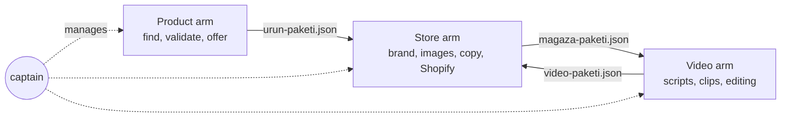

<p align="center">
  
</p>

<h1 align="center">Viral Ürün Ekibi</h1>

<p align="center">
  <b>Find a viral product, build the Shopify store, produce the AI product video:<br>a Turkish-language Claude Code team driven from one command.</b>
</p>

<p align="center">
  <a href="LICENSE"></a>
  
  <a href="https://github.com/armanvibecoding/viral-urun-ekibi-market/actions/workflows/ci.yml"></a>
</p>

<p align="center"><a href="README.md">Türkçe</a> · English</p>

**Viral Ürün Ekibi** ("Viral Product Team") is a Claude Code plugin: one lead skill plus a team of sub-agents that
(1) scouts viral product videos on Instagram Reels/Explore, (2) finds not-yet-viral look-alikes on AliExpress from the shared
"viral DNA" of winners, (3) builds the Shopify store for a validated product (brand, gallery images, copy, setup, site audit),
(4) plans and generates AI product videos with ChatGPT (start frames) and Google Flow (clips) and (5) edits them with ffmpeg
(QC, captions, SFX, loudness). The arms hand work to each other through JSON bridge files. It ships with a knowledge base distilled
from hundreds of analysed products and videos and keeps per-project memory in a `.ekip/` folder.

All user-facing text is Turkish; contributions and issues in English are welcome.

## Quick start

**Claude Code (recommended)**

1. Install Claude Code and sign in (`claude` → `/login`).
2. Install the plugin:
   ```
   /plugin marketplace add armanvibecoding/viral-urun-ekibi-market
   /plugin install viral-urun-ekibi@viral-urun-market
   ```
3. In an empty folder run `claude` and type `/viral-urun-ekibi:captain`.

**ChatGPT**

1. Download `viral-urun-ekibi-CHATGPT-v0.5.0.zip` from the [latest release](https://github.com/armanvibecoding/viral-urun-ekibi-market/releases/latest) (do not unzip). Claude.ai / Claude app users take `viral-urun-ekibi-CLAUDE-v0.5.0.zip` instead (Customize → Plugins → Add → Upload plugin).
2. ChatGPT → **Plugins** → upload the ZIP.
3. Start a new chat: `Ekibi başlat. Pazarım Türkiye.` ("Start the team. My market is Turkey.")

Prerequisites: Claude Pro/Max/Ultra, Google Chrome, `ffmpeg` and `python3 -m pip install --user openpyxl pillow imageio-ffmpeg numpy`.
The iPhone-mirroring mode is Mac-only; the browser mode works everywhere. Full setup (Windows included): [claude/README.md](claude/README.md) and [chatgpt/README.md](chatgpt/README.md) (Turkish).

## How it works



The store-building arm (`builder` skill) ships inside the same plugin. Schemas for the three bridge files live in
`plugins/viral-urun-ekibi/ortak/sozlesme/`.

## Red lines

The team asks for approval before any step that spends money (Flow credits, orders, ads), never types passwords, never follows,
comments or DMs on Instagram, and never invents numbers it cannot verify.

## Disclaimer

Independent open-source project, not affiliated with Instagram, Meta, AliExpress, Shopify, Google, OpenAI or Anthropic. You are responsible
for complying with those services' terms and local regulations. No income or outcome is promised. See [PRIVACY.md](PRIVACY.md).

## Contributing

See [CONTRIBUTING.md](CONTRIBUTING.md) (Turkish; English PRs welcome), [SECURITY.md](SECURITY.md) and [CODE_OF_CONDUCT.md](CODE_OF_CONDUCT.md).
License: [MIT](LICENSE). Bundled HyperFrames skills are Apache-2.0 (© HeyGen, Inc.): [THIRD_PARTY_NOTICES.md](plugins/viral-urun-ekibi/THIRD_PARTY_NOTICES.md).
