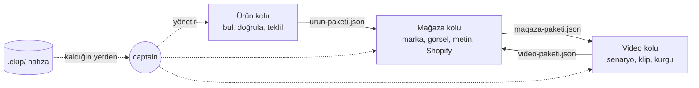

<p align="center">
  
</p>

<h1 align="center">Viral Ürün Ekibi</h1>

<p align="center">
  <b>Viral ürünü bul, Shopify mağazanı kur, AI ürün videosunu üret:<br>tek komutla çalışan, Türkçe bir Claude Code ekibi.</b>
</p>

<p align="center">
  <a href="LICENSE"></a>
  
  <a href="https://github.com/armanvibecoding/viral-urun-ekibi-market/actions/workflows/ci.yml"></a>
  
</p>

<p align="center">Türkçe · <a href="README.en.md">English</a></p>

**Viral Ürün Ekibi**, Claude Code için tek liderli bir e-ticaret ekibidir (eklenti = beceriler + ajanlar). Instagram'da viral ürünleri bulur,
AliExpress'te henüz patlamamış benzerlerini avlar, Shopify mağazanı kurar, ChatGPT + Google Flow ile ürün videosu üretir ve ffmpeg ile kurgular.
İçinde yüzlerce ürün ve viral video analizinden damıtılmış bir bilgi bankası ve proje başına kendiliğinden tutulan hafıza vardır.

## Hangi paketi indireceğim?

| Hangisini kullanıyorsun? | İndir (Releases) | Nereye yükle | Ayrıntı |
|---|---|---|---|
| **Claude Code** (terminal; önerilen, hattın tamamı) | ZIP gerekmez: `/plugin marketplace add armanvibecoding/viral-urun-ekibi-market` | Claude Code içinde | [claude/README.md](claude/README.md) |
| **claude.ai / Claude uygulaması** | [`viral-urun-ekibi-CLAUDE-v0.4.0.zip`](https://github.com/armanvibecoding/viral-urun-ekibi-market/releases/latest) | Customize → Plugins → Add → **Upload plugin** | [claude/README.md](claude/README.md) |
| **ChatGPT** | [`viral-urun-ekibi-CHATGPT-v0.4.0.zip`](https://github.com/armanvibecoding/viral-urun-ekibi-market/releases/latest) | ChatGPT → **Plugins** → yükle | [chatgpt/README.md](chatgpt/README.md) |
| **Proje** (kurulumsuz; claude.ai ya da ChatGPT Projesi) | [`chatgpt/proje-paketi/`](chatgpt/proje-paketi/KURULUM.md) klasörü | Projects → talimat + dosyalar | [chatgpt/proje-paketi/KURULUM.md](chatgpt/proje-paketi/KURULUM.md) |

İki ZIP'i karıştırma: **CLAUDE** olan yalnız Claude'a, **CHATGPT** olan yalnız ChatGPT'ye yüklenir. ZIP'ler depoda tutulmaz, her sürümde Releases'a eklenir.

## Ne yapar?

1. **Ürün bulur:** Instagram Reels/Keşfet'te viral ürün videolarını izler, ölçütlerle ayıklar, tabloya yazar.
2. **Fırsat avlar:** viral ürünlerin ortak DNA'sından AliExpress'te henüz viral olmamış adayları bulur, "zaten viral mi" kontrolü yapar, SAT / İZLE / ELE diye sıralar.
3. **Trendyol fırsatı avlar (`bazaar`):** Trendyol'da ilgi gören, henüz viral olmamış ucuz ürünü bulur; net marj ve fiyat şeffaflığı riskini hesaplar.
4. **Mağaza kurar (`builder`):** 3 aşamada: Plan (araştırma, teklif, marka, site metinleri), Görseller, Site (Shopify kurulumu ve denetim). 10 rollü kadro, toplam 17 ajan.
5. **Video üretir:** ürün kartı, 30 senaryo, ChatGPT ile başlangıç kareleri, Google Flow ile klipler, ffmpeg ile kurgu ve teslim.

## Kimin için?

- **Kimin için:** Türkiye ya da ABD pazarında e-ticaret/dropshipping kuran, kod bilmeyen girişimci. Bilgisayarında Claude Code kurabilen yeter.
- **Kimin için değil:** hazır kazanç, garanti sonuç ya da şifre/hesap devri arayanlar. Ekip karar önerir, kanıtı gösterir; para harcayan her adım senin onayındır.

## Nasıl çalışır?

Tek giriş `captain`dir; işi doğru kola verir ve kollar birbirleriyle dosyayla konuşur:



Adım adım akış, beceri listesi ve mağaza kolu ayrıntısı: [claude/README.md](claude/README.md).

## Uyarı

Bu bağımsız bir açık kaynak projedir; Instagram, Meta, AliExpress, Shopify, Google, OpenAI ve Anthropic ile bağlantısı ya da onayı yoktur.
Bu servislerin kullanım şartlarına ve yerel mevzuata (reklam, tüketici hukuku, vergi) uymak sana aittir. Ekip karar önerir; satış, gelir
ya da sonuç garantisi vermez. Veri ve gizlilik: [PRIVACY.md](PRIVACY.md).

## Depo yapısı

```
.
├── claude/                      Claude parçasının rehberi (README.md)
├── chatgpt/                     ChatGPT parçası: README.md · proje-paketi/ (Proje yolu için yüklenecek dosyalar)
├── plugins/viral-urun-ekibi/    Claude eklentisinin kendisi (beceriler, ajanlar, ortak bilgi, kancalar); katalog bunu gösterir
├── moduller/magaza-kurucu/      mağaza kolunun KAYNAĞI; skills/builder/ buradan üretilir, elle düzenlenmez
├── scripts/                     doğrulama ve paket üretim betikleri (paketle.sh, anonim_kontrol, sozlesme_test ...)
├── docs/                        SARTNAME.md (geliştirici şartnamesi) · assets/ (görseller)
│   └── gelistirici/             iç plan ve analiz kayıtları (okumak zorunda değilsin)
├── .github/                     CI, issue ve PR şablonları
└── CHANGELOG.md · CONTRIBUTING.md · SECURITY.md · PRIVACY.md · CODE_OF_CONDUCT.md · LICENSE
```

## Katkı, güvenlik, lisans

- **Katkı:** yeni beceri, düzeltme ya da bilgi bankası katkısı Pull Request ile kabul edilir: [CONTRIBUTING.md](CONTRIBUTING.md) ·
  şartname ve sözlük: [docs/SARTNAME.md](docs/SARTNAME.md) · değişiklik geçmişi: [CHANGELOG.md](CHANGELOG.md).
  PR öncesi `claude plugin validate plugins/viral-urun-ekibi`, `python3 scripts/sozlesme_test.py`, `python3 scripts/butce_kontrol.py` ve
  mağaza kolu testleri geçmeli; kişisel bilgi (ad, e-posta, mağaza, hesap, mutlak yol, API anahtarı) içermemeli.
- **Güvenlik açığı:** herkese açık issue açma, [SECURITY.md](SECURITY.md)'deki özel kanalı kullan. Davranış kuralları: [CODE_OF_CONDUCT.md](CODE_OF_CONDUCT.md).
- **Lisans:** [MIT](LICENSE), © viral-urun-ekibi contributors.
  HyperFrames becerileri (`skills/hyperframes*`, `skills/media-use`) Apache-2.0 lisanslıdır (© HeyGen, Inc.): [THIRD_PARTY_NOTICES.md](plugins/viral-urun-ekibi/THIRD_PARTY_NOTICES.md).

## Terimler

| Biz böyle yazıyoruz | Anlamı |
|---|---|
| eklenti | Claude Code plugin'i (bu paketin kendisi) |
| beceri | skill: tek bir işi yaptıran yönerge paketi (`skills/<ad>/SKILL.md`) |
| ajan | alt ajan: ekibin bir rolü (`agents/<ad>.md`) |
| eklenti kataloğu | marketplace: eklentiyi kurdurduğun depo |
| hedef ülke / pazar | satış yapılan ülke (Türkiye, ABD) |
