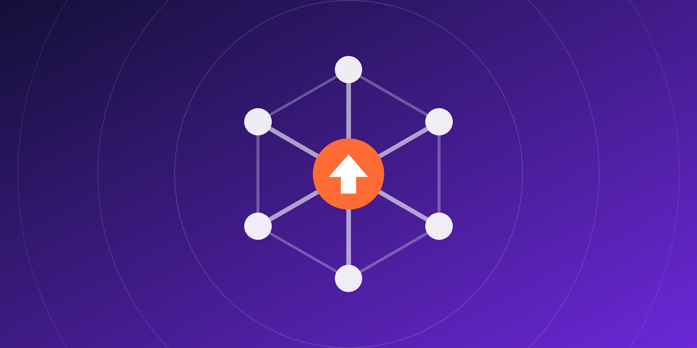
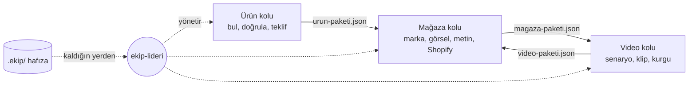

<p align="center">
  
</p>

<h1 align="center">Viral Ürün Ekibi</h1>

<p align="center">
  <b>Viral ürünü bul, Shopify mağazanı kur, AI ürün videosunu üret:<br>tek komutla çalışan, Türkçe bir Claude Code ekibi.</b>
</p>

<p align="center">
  <a href="LICENSE"></a>
  
  <a href="https://github.com/armanvibecoding/viral-urun-ekibi-market/actions/workflows/ci.yml"></a>
  
</p>

<p align="center">Türkçe · <a href="README.en.md">English</a></p>

**Viral Ürün Ekibi**, Claude Code için tek liderli bir e-ticaret ekibidir (eklenti = beceriler + ajanlar). Instagram'da viral ürünleri bulur,
AliExpress'te henüz patlamamış benzerlerini avlar, Shopify mağazanı kurar, ChatGPT + Google Flow ile ürün videosu üretir ve ffmpeg ile kurgular.
İçinde yüzlerce ürün ve viral video analizinden damıtılmış bir bilgi bankası ve proje başına kendiliğinden tutulan hafıza vardır.

## Hızlı başlangıç

**Claude Code ile (önerilen)**

1. Claude Code'u kur, `claude` → `/login` ile giriş yap.
2. Eklentiyi kur:
   ```
   /plugin marketplace add armanvibecoding/viral-urun-ekibi-market
   /plugin install viral-urun-ekibi@viral-urun-market
   ```
3. Boş bir klasörde `claude` çalıştır ve yaz: `/viral-urun-ekibi:ekip-lideri`

**ChatGPT ile**

1. [Releases](https://github.com/armanvibecoding/viral-urun-ekibi-market/releases/latest) sayfasından `viral-urun-ekibi-chatgpt.zip` dosyasını indir (açma).
2. ChatGPT → **Plugins** → yükleme seçeneğiyle ZIP'i yükle.
3. Yeni sohbette yaz: `Ekibi başlat. Pazarım Türkiye.`

Ön koşullar (ffmpeg, Python paketleri, Chrome eklentisi, Windows) ve ayrıntılar aşağıda: [Yol A](#yol-a-claude-code-eklentisi) · [Yol C](#yol-c-chatgpt-paketi).

## Ne yapar?

1. **Ürün bulur:** Instagram Reels/Keşfet'te viral ürün videolarını izler, ölçütlerle ayıklar, tabloya yazar.
2. **Fırsat avlar:** viral ürünlerin ortak DNA'sından AliExpress'te henüz viral olmamış adayları bulur, "zaten viral mi" kontrolü yapar, SAT / İZLE / ELE diye sıralar.
3. **Mağaza kurar:** marka, görsel, metin, Shopify kurulumu ve site denetimi (27 ajanlık kadro).
4. **Video üretir:** ürün kartı, 30 senaryo, ChatGPT ile başlangıç kareleri, Google Flow ile klipler, ffmpeg ile kurgu ve teslim.

## Kimin için?

- **Kimin için:** Türkiye ya da ABD pazarında e-ticaret/dropshipping kuran, kod bilmeyen girişimci. Bilgisayarında Claude Code kurabilen yeter.
- **Kimin için değil:** hazır kazanç, garanti sonuç ya da şifre/hesap devri arayanlar. Ekip karar önerir, kanıtı gösterir; para harcayan her adım senin onayındır.

## Nasıl çalışır?

Tek giriş `ekip-lideri`dir; işi doğru kola verir ve kollar birbirleriyle dosyayla konuşur:



1. `AliExpress'ten ürün bul` → SAT kararını onayla → ekip `is/NN-urun-adi/urun-paketi.json` yazar (`ortak/paket.py urun-yaz`).
2. `Bu ürün için mağaza kur` → mağaza kolu fotoğraf + ülke sormadan başlar, sonunda `is/NN-urun-adi/magaza-paketi.json` verir.
3. `Bu ürüne video yap` → ekip mağaza paketini okur (`paket.py magaza-oku` → `marka-kilidi.md`): aynı renkler, aynı yazı ailesi,
   yalnız onaylı iddialar, mağaza linki. Teslimde `teslim/video-paketi.json` çıkar (`paket.py video-yaz`).
4. `pdp-galeri` / `hero` işaretli videolar ürün sayfası galerisine girer; `reklam` işaretliler mağazaya yüklenmez.

Üç dosyanın şeması ve doğrulayıcısı: `plugins/viral-urun-ekibi/ortak/sozlesme/` (alan tablosu: `arayuz-sozlesmesi.md`).
Üretim yapmadan uçtan uca deneme: `python3 scripts/sozlesme_test.py`.

## Hangi yolu seçmeliyim?

| Yol | Ne yapabilir | Kim için |
|---|---|---|
| **A. Claude Code eklentisi** (önerilen) | Hattın tamamı: Instagram'da gezinme, AliExpress tarama, Shopify mağaza kurulumu ve site denetimi (27 ajanla), Flow'da üretim, ffmpeg ile kurgu. Hafıza kendiliğinden tutulur. Görseller ChatGPT'de üretilir. | Bilgisayarında Claude Code kurabilen herkes (Mac en iyisi, Windows destekli) |
| **B. claude.ai veya ChatGPT Projesi** | Sohbette bilgi bankasıyla ürün yorumu, viral analiz, 30 senaryo, istem yazımı. Tarayıcı/kurgu yok ya da sınırlı. | Hiç kurulum istemeyen herkes |
| **C. ChatGPT paketi** | 16 beceri (8 iş akışı + 7 ekip rolü + bilgi bankası) ChatGPT'de; betikler kod yorumlayıcıda. Mağaza kolu tam çalışır. Tarayıcı, telefon ve Flow adımlarını kullanıcı yapar; alt ajan, oturum kancası ve hareketli tasarım yok. | ChatGPT'de Plugins yükleme seçeneği olan herkes |

### Yol A: Claude Code eklentisi

Ön koşul: Claude Pro, Max veya Ultra planı · Google Chrome · Mac için `brew install ffmpeg` ve
`python3 -m pip install --user openpyxl pillow imageio-ffmpeg numpy` (Windows'ta iPhone modu yok, tarayıcı modu çalışır).

1. Claude Code'u kur ve giriş yap (`claude` → `/login`).
2. Eklentiyi kur (yukarıdaki iki komut). Mağaza kolu aynı eklentinin içindedir; ayrı kurulum yok. Güncellemeleri kendiliğinden almak için: `/plugin` → Marketplaces → Enable auto-update.
3. Araç izinleri:
   - Chrome'a "Claude" eklentisini kur, Claude Code'da `/chrome` ile bağla.
   - Mac + iPhone modu için: `/mcp` → computer-use → Enable; Sistem Ayarları'nda Erişilebilirlik ve Ekran Kaydı izni; iPhone Yansıtma'yı bir kez elle aç.
4. Boş klasörde `/viral-urun-ekibi:ekip-lideri` çalıştır. Lider hafıza klasörünü (`.ekip/`) kurar, eksik araçları kontrol eder ve sana hedef ülkeni (Türkiye/ABD) sorar.

<details>
<summary>Windows kurulumu</summary>

PowerShell'de sırayla `winget install Git.Git`, `winget install Python.Python.3.12`, `winget install Gyan.FFmpeg`,
sonra `py -m pip install --user openpyxl pillow imageio-ffmpeg numpy`. Komutlarda `python3` yerine `py -3` kullanılır
(`python3` yazmak Microsoft Store'u açar).
</details>

Depo herkese açıktır; ayrı erişim gerekmez. Kendi çatalını (fork) kuracaksan komuttaki depo adını kendininkiyle değiştir.

### Yol B: claude.ai veya ChatGPT Projesi

Bilgi bankası dosyalarını bir Projeye yükleyip talimatı yapıştırırsın; adım adım rehber:
`plugins/viral-urun-ekibi/ekler/proje-paketi/KURULUM.md`. Yüklenecek dosyaları yeniden üretmek: `sh scripts/proje_paketi_yap.sh`.

### Yol C: ChatGPT paketi

1. [Releases](https://github.com/armanvibecoding/viral-urun-ekibi-market/releases/latest) sayfasından `viral-urun-ekibi-chatgpt.zip` dosyasını indir. ZIP'i açma.
2. ChatGPT → **Plugins** → yükleme seçeneği. İş alanında: yönetici konsolu → **Plugins** → **Add** → **Upload plugin**. Seçenek yoksa
   **Plugins → Skills → Create → Upload** ile `skills/` altındaki klasörleri tek tek yükle (önce `ekip-bilgi` ve `ekip-lideri`).
   Kişisel hesapta hangi planın gerektiği belgelerde net değil.
3. Yeni sohbette yaz: `Ekibi başlat. Pazarım Türkiye.` Her cevabın sonunda DURUM bloğu çıkar; yeni sohbete geçerken onu yapıştır.

ChatGPT'de tarayıcı, telefon ve Google Flow adımlarını sen yaparsın (ekran görüntüsü/metin yüklersin); liste `ekip-lideri` becerisinin başında.
ZIP depoda tutulmaz, her sürümde Releases'a yüklenir. Kendin üretmek istersen: `sh scripts/chatgpt_paketi_yap.sh` → `dist/viral-urun-ekibi-chatgpt.zip`.
Plugin yüklenemezse Yol B (Proje + talimat) aynı bilgi bankasıyla çalışır.

## Kullanım örnekleri

- "Instagram'dan bugün 20 viral ürün bul."
- "Bulduğumuz ürünlerin ortak noktasına göre AliExpress'ten 5 yeni ürün getir."
- "Şu ürün için ABD pazarına 30 video planı yap: <link>"
- "V01–V05'in kliplerini kurgula ve teslim et."
- "Bu ürün için mağaza kur. Ülke: Türkiye." (ürün fotoğrafını ekle)
- "SAT olan ürünü Shopify'a aç, sonra videosunu mağazanın renkleriyle yap."
- "Kurulu mağazayı denetle: hız, arama, erişilebilirlik, satın alma kutusu."
- "Nerede kalmıştık?"

## Eklentinin içi

**Beceriler** (`plugins/viral-urun-ekibi/skills/`)

| Beceri | Ne yapar |
|---|---|
| `ekip-lideri` | Ekibin TEK lideri ve tek girişi: işi doğru kola verir, `.ekip/` hafızasını tutar, kollar arası köprü dosyalarını yazar, eksik araçları kontrol eder. |
| `magaza-kurucu` | Mağaza kolu: ürün fotoğrafı + ülkeden ya da ekibin `urun-paketi.json` dosyasından Shopify mağazası (5 aşama: ürün analizi, marka, görseller, metinler, kurulum + site denetimi). Tema paketi yoksa temasız modda çalışır. |
| `kesfet-urun-avi` | Instagram Reels/Keşfet'te viral ürün videolarını izler, ölçütlerle ayıklar, tabloya ve Excel'e kaydeder (Mac: iPhone Yansıtma; her yerde: Chrome). |
| `aliexpress-firsat` | Viral ürünlerin ortak DNA'sından arama terimi üretir, AliExpress'te henüz viral olmamış adayları bulur ve "zaten viral mi" kontrolü yapar. |
| `ai-video-kreatif` | Ürün kartı, 30 senaryo, ChatGPT ile başlangıç kareleri ve Google Flow ile klip üretimi. |
| `video-kurgu` | ffmpeg ile kurgu: klip kalite kontrolü, ekran üstü yazı, efekt, ses normalizasyonu, teslim. |
| `reklam-kutuphanesi-avi` | Meta Reklam Kütüphanesi'nde niş niş (US/TR/AB) kazanan reklam ve ürün taraması; mağaza → AliExpress eşleme, kazanan–kaybeden desen sayımı. |
| `teklif-ve-sayfa` | Kazanan ürün için teklif, iniş sayfası, itiraz bankası ve e-posta taslağı; baskı/sahte indirim ifadesi denetçisi. |
| `hyperframes`, `hyperframes-cli`, `hyperframes-registry`, `media-use` | Hareketli tasarım katmanı (HeyGen'in açık kaynak HyperFrames paketi, Apache-2.0, değiştirilmeden): HTML'den video, kinetik yazı, geçiş, altyazı, ~450 hazır blok; render yerelde Node 22+ ve Chrome ister. `video-kurgu` aşama 8b'de çağrılır. |

**Ajanlar** (`plugins/viral-urun-ekibi/agents/`, 27 üye): çekirdek ekip 7 (`video-juri` kör video jürisi, `firsat-avcisi`, `kanit-savcisi`, `icerik-stratejisti`,
`kreatif-analisti`, `video-elestirmen`, `ses-tasarimcisi`) + mağaza kolu 20 (marka, görsel, site, denetim). Her üyenin İngilizce
unvanı, adı, Türkçe rolü ve modeli: `plugins/viral-urun-ekibi/ortak/ekip.md`.

**Ortak bilgi** (`plugins/viral-urun-ekibi/ortak/`): marka skoru, viral DNA, sözlük ve `bilgi/` altında ürün kataloğu,
kreatif notlar, fırsat geçmişi, üretim deneyimi, dersler.

### Mağaza kolu nasıl çalışır?

- **Tek giriş:** "mağaza kur" da dahil her iş `ekip-lideri` ile başlar. Ürün ekipten geldiyse kanıt, rakipler ve onaylı teklif
  `urun-paketi.json` ile mağazaya taşınır; hiçbir şey yeniden sorulmaz. Doğrudan fotoğraf + ülke vermek de yeterlidir.
- **Fiyatın tek kaynağı:** teklif tablosunda `bizim` satırı varsa o; yoksa sabit kural (2'li %10, 3'lü %18).
- **Tema:** mağaza aşaması özel bir tema paketiyle (tam mod) çalışacak biçimde yazıldı; paket bu depoda yok. Paketin yoksa
  **temasız mod** devreye girer: ürün, metin, görsel, sayfalar ve indirim Shopify'a, mağazanın mevcut temasına yazılır; tema
  şablonu yazılmaz ve senden tema istenmez.
- **Shopify bağlantısı:** eklenti Shopify'ın uzak bağlantısını (`.mcp.json`) getirir; ilk kullanımda `/mcp` → shopify ile giriş yaparsın.
- **Video mağazayla aynı sistemde:** altyazı ve kapak mağazanın yazı ailesini ve renklerini kullanır; videoda yalnız mağazanın
  onaylı iddiaları söylenir (kapı: `kurgu_kontrol.py --magaza-paketi`).
- **Model:** lider en güçlü modelle çalışmalı: oturumu `/model fable` ile aç (yoksa opus). En güçlü model yalnız kör jüri, kök neden ve strateji rollerinde
  (`model: fable`; hesabında yoksa o dosyalarda `opus` yaz); hacimli işler `sonnet`, ölçülebilir her şey betik (`ortak/ekip.md`).
- Claude görsel üretmez: mağazanın görsel adımında görseller ChatGPT'de üretilip sohbete eklenir.

## Hafıza nasıl çalışır?

Her proje klasöründe `.ekip/` vardır: `DURUM.md` (nerede kaldık, sıradaki adım), `KARARLAR.md` (verdiğin kararlar),
`DERSLER.md` (öğrenilen dersler). Oturum açıldığında veya sohbet sıkıştırıldığında bu dosyalar Claude'a otomatik
yeniden okutulur; yeni oturumda kaldığı yerden devam eder. Ürün çıktıları `is/` klasöründedir. Bunlar senin proje klasöründe kalır, eklentiye yazılmaz.

## Kırmızı çizgiler (ekip bunlara uyar)

- Flow kredisi, sipariş, reklam gibi para harcayan her adımdan önce onay ister.
- Şifre girmez; giriş ekranında sana devreder.
- Instagram'da takip, yorum, DM, satın alma yapmaz.
- Başka markaların logosunu videolarda kullanmaz; doğrulayamadığı sayıyı uydurmaz.

## Bilinen sınırlar

- iPhone modu yalnız Mac (macOS 15+, iPhone Yansıtma). Ekran noktaları ilk kullanımda kalibrasyon ister.
- Google Flow arayüzü değişirse otomatik yükleme bozulabilir; o durumda ekip senden tek bir sürükle-bırak ister.
- ChatGPT, kendi tarayıcı eklentisi modunda dosyaları Flow'a yükleyemez; ChatGPT ile video üretiminde bulut tarayıcıda Google girişi gerekir.

## Uyarı

Bu bağımsız bir açık kaynak projedir; Instagram, Meta, AliExpress, Shopify, Google, OpenAI ve Anthropic ile bağlantısı ya da onayı yoktur.
Bu servislerin kullanım şartlarına ve yerel mevzuata (reklam, tüketici hukuku, vergi) uymak sana aittir. Ekip karar önerir; satış, gelir
ya da sonuç garantisi vermez. Veri ve gizlilik: [PRIVACY.md](PRIVACY.md).

## Depo yapısı

```
.
├── plugins/viral-urun-ekibi/    kullanıcıya giden eklenti (beceriler, ajanlar, ortak bilgi, kancalar)
├── moduller/magaza-kurucu/      mağaza kolunun KAYNAĞI; skills/magaza-kurucu/ buradan üretilir, elle düzenlenmez
├── scripts/                     doğrulama ve paket üretim betikleri (anonim_kontrol, sozlesme_test, chatgpt_paketi_yap ...)
├── docs/                        SARTNAME.md (geliştirici şartnamesi) · assets/ (görseller)
│   └── gelistirici/             iç plan ve analiz kayıtları (okumak zorunda değilsin)
├── .github/                     CI, issue ve PR şablonları
└── CHANGELOG.md · CONTRIBUTING.md · SECURITY.md · PRIVACY.md · CODE_OF_CONDUCT.md · LICENSE
```

## Katkı, güvenlik, lisans

- **Katkı:** yeni beceri, düzeltme ya da bilgi bankası katkısı Pull Request ile kabul edilir: [CONTRIBUTING.md](CONTRIBUTING.md) ·
  şartname ve sözlük: [docs/SARTNAME.md](docs/SARTNAME.md) · değişiklik geçmişi: [CHANGELOG.md](CHANGELOG.md).
  PR öncesi `claude plugin validate plugins/viral-urun-ekibi`, `python3 scripts/sozlesme_test.py`, `python3 scripts/butce_kontrol.py` ve
  mağaza kolu testleri geçmeli; kişisel bilgi (ad, e-posta, mağaza, hesap, mutlak yol, API anahtarı) içermemeli.
- **Güvenlik açığı:** herkese açık issue açma, [SECURITY.md](SECURITY.md)'deki özel kanalı kullan. Davranış kuralları: [CODE_OF_CONDUCT.md](CODE_OF_CONDUCT.md).
- **Lisans:** [MIT](LICENSE), © viral-urun-ekibi contributors.
  HyperFrames becerileri (`skills/hyperframes*`, `skills/media-use`) Apache-2.0 lisanslıdır (© HeyGen, Inc.): [THIRD_PARTY_NOTICES.md](plugins/viral-urun-ekibi/THIRD_PARTY_NOTICES.md).

## Terimler

| Biz böyle yazıyoruz | Anlamı |
|---|---|
| eklenti | Claude Code plugin'i (bu paketin kendisi) |
| beceri | skill: tek bir işi yaptıran yönerge paketi (`skills/<ad>/SKILL.md`) |
| ajan | alt ajan: ekibin bir rolü (`agents/<ad>.md`) |
| eklenti kataloğu | marketplace: eklentiyi kurdurduğun depo |
| hedef ülke / pazar | satış yapılan ülke (Türkiye, ABD) |
