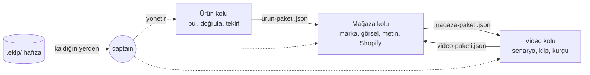

# Claude parçası: Viral Ürün Ekibi eklentisi

Hattın tamamı burada çalışır: Instagram'da ürün bulma, AliExpress ve Trendyol tarama, Shopify mağaza kurulumu ve site denetimi (17 ajan),
Google Flow'da üretim, ffmpeg ile kurgu, kendiliğinden tutulan hafıza. Eklentinin kendisi `plugins/viral-urun-ekibi/` klasöründedir
(katalog `.claude-plugin/marketplace.json` bunu gösterir). Sürüm: 0.4.0. Güncelledikten sonra oturumu yeniden başlat.

## Hangi yoldan kuracağım?

| Nerede kullanıyorsun? | Ne indir / yaz | Nereye yükle |
|---|---|---|
| **Claude Code** (terminal, önerilen) | ZIP gerekmez: aşağıdaki iki `/plugin` komutu | Claude Code içinde |
| **claude.ai veya Claude uygulaması** | [Releases](https://github.com/armanvibecoding/viral-urun-ekibi-market/releases/latest) → `viral-urun-ekibi-CLAUDE-v0.4.0.zip` (açma) | **Customize → Plugins → Add → Upload plugin** |

Claude ZIP'inde tam eklenti vardır (beceriler, ajanlar, kancalar, ortak bilgi, HyperFrames). Ajanlar ve kancalar Cowork ile Claude Code'da çalışır;
claude.ai sohbeti bunları hata vermeden yok sayar (resmî doküman: [claude.com/docs/plugins/build](https://claude.com/docs/plugins/build)).
Bu yüzden hattın tamamı için Claude Code önerilir. ZIP'in boyut sınırı resmî dokümanda kişisel hesap için belirtilmemiş; yükleme reddederse
Claude Code yolunu kullan.

## Claude Code kurulumu (3 adım)

1. Claude Code'u kur, `claude` → `/login` ile giriş yap.
2. Eklentiyi kur:
   ```
   /plugin marketplace add armanvibecoding/viral-urun-ekibi-market
   /plugin install viral-urun-ekibi@viral-urun-market
   ```
   Güncellemeleri kendiliğinden almak için: `/plugin` → Marketplaces → Enable auto-update.
3. Boş bir klasörde `claude` çalıştır ve yaz: `/viral-urun-ekibi:captain`. Lider hafıza klasörünü (`.ekip/`) kurar, eksik araçları kontrol eder ve hedef ülkeni (Türkiye/ABD) sorar.

## Gereksinimler

- Claude Pro, Max veya Ultra planı · Google Chrome (Chrome'a "Claude" eklentisini kur, Claude Code'da `/chrome` ile bağla).
- Mac: `brew install ffmpeg` ve `python3 -m pip install --user openpyxl pillow imageio-ffmpeg numpy`.
- Mac + iPhone modu: `/mcp` → computer-use → Enable; Sistem Ayarları'nda Erişilebilirlik ve Ekran Kaydı izni; iPhone Yansıtma'yı bir kez elle aç. Windows'ta iPhone modu yok, tarayıcı modu çalışır.
- Hareketli tasarım (HyperFrames) için yerelde Node 22+ ve Chrome.

<details>
<summary>Windows kurulumu</summary>

PowerShell'de sırayla `winget install Git.Git`, `winget install Python.Python.3.12`, `winget install Gyan.FFmpeg`,
sonra `py -m pip install --user openpyxl pillow imageio-ffmpeg numpy`. Komutlarda `python3` yerine `py -3` kullanılır
(`python3` yazmak Microsoft Store'u açar).
</details>

Depo herkese açıktır; ayrı erişim gerekmez. Kendi çatalını (fork) kuracaksan komuttaki depo adını kendininkiyle değiştir.

## Beceriler, ajanlar ve ortak bilgi

**Beceriler** (`plugins/viral-urun-ekibi/skills/`)

| Beceri | Ne yapar |
|---|---|
| `captain` | Ekibin TEK lideri ve tek girişi: işi doğru kola verir, `.ekip/` hafızasını tutar, kollar arası köprü dosyalarını yazar, eksik araçları kontrol eder. |
| `builder` | Mağaza kolu: ürün fotoğrafı + ülkeden ya da ekibin `urun-paketi.json` dosyasından Shopify mağazası (3 aşama: ① Plan = araştırma, teklif, marka, site metinleri; ② Görseller; ③ Site = kurulum ve denetim). Tema paketi yoksa temasız modda çalışır. |
| `radar` | Instagram Reels/Keşfet'te viral ürün videolarını izler, ölçütlerle ayıklar, tabloya ve ortak şablonlu Excel'e kaydeder (Mac: iPhone Yansıtma; her yerde: Chrome). |
| `hunter` | Viral ürünlerin ortak DNA'sından arama terimi üretir, AliExpress'te henüz viral olmamış adayları bulur ve "zaten viral mi" kontrolü yapar. |
| `studio` | Ürün kartı, 30 senaryo, ChatGPT ile başlangıç kareleri ve Google Flow ile klip üretimi. |
| `cut` | ffmpeg ile kurgu: klip kalite kontrolü, ekran üstü yazı, efekt, ses normalizasyonu, teslim. |
| `spy` | Meta Reklam Kütüphanesi'nde niş niş (US/TR/AB) kazanan reklam ve ürün taraması; mağaza → AliExpress eşleme, kazanan–kaybeden desen sayımı. |
| `bazaar` | Trendyol'da ilgi gören, henüz viral olmamış, ucuz ürünü bulur; net marj, tedarik ve fiyat şeffaflığı riskini hesaplar. Satış kendi Shopify mağazamızda. |
| `hyperframes`, `hyperframes-cli`, `hyperframes-registry`, `media-use` | Hareketli tasarım katmanı (HeyGen'in açık kaynak HyperFrames paketi, Apache-2.0, değiştirilmeden): HTML'den video, kinetik yazı, geçiş, altyazı, ~450 hazır blok; render yerelde Node 22+ ve Chrome ister. `cut` aşama 8b'de çağrılır. |

**Ajanlar** (`plugins/viral-urun-ekibi/agents/`, 17 üye): ürün ve video tarafında 7 (`scout`, `skeptic`, `decoder`, `story`, `jury` kör video jürisi,
`fixer`, `mixer`) + mağaza kolu 10 (`atlas`, `muse`, `copy`, `forge`, `sentinel`, `panel`, `director`, `architect`, `probe`, `shopper`). Her üyenin kod adı,
Türkçe rolü ve modeli: `plugins/viral-urun-ekibi/ortak/ekip.md`. Eski adlar için: `ortak/ad-haritasi.tsv`. Eski beceri adları bu sürümde yönlendirme olarak çalışır (liste: `ortak/ad-haritasi.tsv`), 0.5.0'da kalkar.

**Ortak bilgi** (`plugins/viral-urun-ekibi/ortak/`): marka skoru, viral DNA, sözlük ve `bilgi/` altında ürün kataloğu,
kreatif notlar, fırsat geçmişi, üretim deneyimi, dersler.

### Mağaza kolu nasıl çalışır?

- **Tek giriş:** "mağaza kur" da dahil her iş `captain` ile başlar. Ürün ekipten geldiyse kanıt, rakipler ve onaylı teklif
  `urun-paketi.json` ile mağazaya taşınır; hiçbir şey yeniden sorulmaz. Doğrudan fotoğraf + ülke vermek de yeterlidir.
- **Fiyatın tek kaynağı:** teklif tablosunda `bizim` satırı varsa o; yoksa sabit kural (2'li %10, 3'lü %18).
- **Tema:** mağaza aşaması özel bir tema paketiyle (tam mod) çalışacak biçimde yazıldı; paket bu depoda yok. Paketin yoksa
  **temasız mod** devreye girer: ürün, metin, görsel, sayfalar ve indirim Shopify'a, mağazanın mevcut temasına yazılır; tema
  şablonu yazılmaz ve senden tema istenmez.
- **Shopify bağlantısı:** eklenti Shopify'ın uzak bağlantısını (`.mcp.json`) getirir; ilk kullanımda `/mcp` → shopify ile giriş yaparsın.
- **Video mağazayla aynı sistemde:** altyazı ve kapak mağazanın yazı ailesini ve renklerini kullanır; videoda yalnız mağazanın
  onaylı iddiaları söylenir (kapı: `kurgu_kontrol.py --magaza-paketi`).
- **Model:** lider en güçlü modelle çalışmalı: oturumu `/model fable` ile aç (yoksa opus). En güçlü model yalnız kör jüri, kök neden ve strateji rollerinde
  (`model: fable`; hesabında yoksa o dosyalarda `opus` yaz); hacimli işler `sonnet`, ölçülebilir her şey betik (`ortak/ekip.md`).
- Claude görsel üretmez: mağazanın görsel adımında görseller ChatGPT'de üretilip sohbete eklenir.

## Nasıl çalışır?

Tek giriş `captain`dir; işi doğru kola verir ve kollar birbirleriyle dosyayla konuşur:



1. `AliExpress'ten ürün bul` → SAT kararını onayla → ekip `is/NN-urun-adi/urun-paketi.json` yazar (`ortak/paket.py urun-yaz`).
2. `Bu ürün için mağaza kur` → mağaza kolu fotoğraf + ülke sormadan başlar, sonunda `is/NN-urun-adi/magaza-paketi.json` verir.
3. `Bu ürüne video yap` → ekip mağaza paketini okur (`paket.py magaza-oku` → `marka-kilidi.md`): aynı renkler, aynı yazı ailesi,
   yalnız onaylı iddialar, mağaza linki. Teslimde `teslim/video-paketi.json` çıkar (`paket.py video-yaz`).
4. `pdp-galeri` / `hero` işaretli videolar ürün sayfası galerisine girer; `reklam` işaretliler mağazaya yüklenmez.

Üç dosyanın şeması ve doğrulayıcısı: `plugins/viral-urun-ekibi/ortak/sozlesme/` (alan tablosu: `arayuz-sozlesmesi.md`).
Üretim yapmadan uçtan uca deneme: `python3 scripts/sozlesme_test.py`.

## Kullanım örnekleri

- "Instagram'dan bugün 20 viral ürün bul."
- "Bulduğumuz ürünlerin ortak noktasına göre AliExpress'ten 5 yeni ürün getir."
- "Şu ürün için ABD pazarına 30 video planı yap: <link>"
- "V01–V05'in kliplerini kurgula ve teslim et."
- "Bu ürün için mağaza kur. Ülke: Türkiye." (ürün fotoğrafını ekle)
- "SAT olan ürünü Shopify'a aç, sonra videosunu mağazanın renkleriyle yap."
- "Kurulu mağazayı denetle: hız, arama, erişilebilirlik, satın alma kutusu."
- "Nerede kalmıştık?"

## Hafıza nasıl çalışır?

Her proje klasöründe `.ekip/` vardır: `DURUM.md` (nerede kaldık, sıradaki adım), `KARARLAR.md` (verdiğin kararlar),
`DERSLER.md` (öğrenilen dersler). Oturum açıldığında veya sohbet sıkıştırıldığında bu dosyalar Claude'a otomatik
yeniden okutulur; yeni oturumda kaldığı yerden devam eder. Ürün çıktıları `is/` klasöründedir. Bunlar senin proje klasöründe kalır, eklentiye yazılmaz.

## Kırmızı çizgiler (ekip bunlara uyar)

- Flow kredisi, sipariş, reklam gibi para harcayan her adımdan önce onay ister.
- Şifre girmez; giriş ekranında sana devreder.
- Instagram'da takip, yorum, DM, satın alma yapmaz.
- Başka markaların logosunu videolarda kullanmaz; doğrulayamadığı sayıyı uydurmaz.

## Bilinen sınırlar

- iPhone modu yalnız Mac (macOS 15+, iPhone Yansıtma). Ekran noktaları ilk kullanımda kalibrasyon ister.
- Google Flow arayüzü değişirse otomatik yükleme bozulabilir; o durumda ekip senden tek bir sürükle-bırak ister.
- ChatGPT, kendi tarayıcı eklentisi modunda dosyaları Flow'a yükleyemez; ChatGPT ile video üretiminde bulut tarayıcıda Google girişi gerekir.

Ana sayfa: [../README.md](../README.md) · ChatGPT parçası: [../chatgpt/README.md](../chatgpt/README.md)
